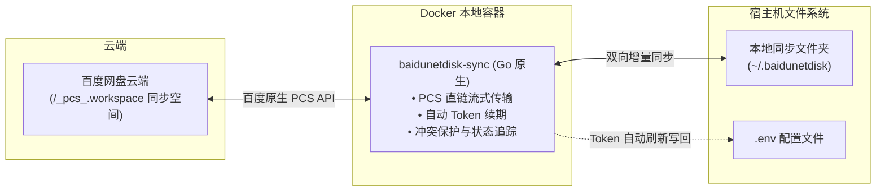

# 百度网盘 Linux 双向离线同步系统 (Go 原生容器版)

专为 Linux 环境打造的百度网盘“同步空间 (Sync Space / `/_pcs_.workspace`)”双向离线增量同步套件。



---

## 🌟 核心优势

- **直连百度网盘同步空间**：直连百度私有同步空间根路径 `/_pcs_.workspace`，避开 OpenList 的 `/api/filemetas` errno 9019 限制与 Rclone 缓存权限问题。
- **免中间层纯原生实现**：采用单二进制 Golang 打造，内存占用 < 20MB，启动秒级响应，无需额外 WebDAV 中转。
- **Token 自动续期与持久化**：借用 `https://api.oplist.org/` 授权接口，支持自动凭证续期并将新 Token 写回 `.env`，彻底解决 Token 过期停摆问题。
- **真正的双向增量同步**：精准感知本地与云端的添加、修改与删除；发生双端修改时自动备份冲突版本（`.conflict-时间戳`），保护数据安全。
- **Docker Compose 一键管理**：支持后台常驻、一键启停、日志追踪与即时手动同步。

---

## 🚀 快速上手

### 1. 获取授权 Token
访问官方授权页面获取令牌：
👉 **https://api.oplist.org/**
- 选择 **百度网盘**，点击授权登录并复制生成的 **Refresh Token**。

### 2. 配置环境变量
复制并编辑 `.env` 文件：
```bash
cp .env.example .env
```
将获取到的 Refresh Token 填入 `BAIDU_REFRESH_TOKEN`：
```ini
LOCAL_SYNC_DIR=/home/nan/.baidunetdisk
REMOTE_ROOT=/_pcs_.workspace
SYNC_INTERVAL=300
CONCURRENCY=4
BAIDU_REFRESH_TOKEN="你的_refresh_token"
```

### 3. 使用 Docker Compose 启动

```bash
# 构建并后台启动同步服务
docker compose up -d

# 查看实时同步日志
docker compose logs -f

# 停止同步服务
docker compose down
```

---

## 🛠️ 常用运维指令

| 需求 | 命令 |
| :--- | :--- |
| **启动后台同步服务** | `docker compose up -d` |
| **查看实时同步日志** | `docker compose logs -f` |
| **停止服务** | `docker compose down` |
| **执行单次即时同步** | `docker compose run --rm baidunetdisk-sync -sync` |
| **演练模式（仅分析不改动）** | `docker compose run --rm baidunetdisk-sync -dry-run` |
| **检查状态概览** | `docker compose run --rm baidunetdisk-sync -status` |
| **重新构建容器镜像** | `docker compose build` |

---

## 📂 项目结构

```
baidunetdisk-sync/
├── Dockerfile               # 容器构建文件 (Alpine 极简镜像)
├── docker-compose.yml       # Docker Compose 服务编排定义
├── .env                     # 本地配置文件 (Token 与路径)
├── .env.example             # 环境变量配置模板
├── client/
│   └── baidu.go             # 百度 PCS API 直连与 Token 自动续期客户端
├── syncer/
│   ├── engine.go            # 双向同步对比与并发执行引擎
│   ├── filter.go            # 忽略规则过滤器 (.git, .DS_Store, 临时文件等)
│   └── state.go             # 本地与远端文件元数据持久化状态管理
├── config/
│   └── config.go            # 配置加载与 Token 持久化回写
└── main.go                  # CLI 入口与守护进程
```
