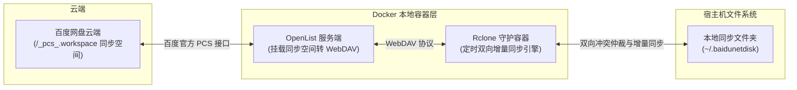

# 百度网盘 Linux 双向离线同步系统 (OpenList + Rclone)

专为 Linux 环境打造的百度网盘“同步空间 (Sync Space)”双向离线同步套件。



---

## 🌟 特性

- **精准对接同步空间**：直连百度网盘私有同步空间根路径 `/_pcs_.workspace`。
- **纯官方 OAuth 授权**：无需提取任何 Cookie 或本地客户端凭证，通过官方 Refresh Token 安全鉴权。
- **真正的双向增量同步**：基于 `rclone bisync`，支持双端修改同步、删除同步与冲突保护。
- **状态不丢失**：工作区元数据与对比快照持久化保存在本地挂载卷，容器重启无需重新 `--resync`。
- **全自动化运维**：集成一键配置脚本、过滤规则、即时手动同步与系统健康状态监测。
- **垃圾文件过滤**：内置 `scripts/filter.txt`，自动忽略 `.git/`、临时文件 `~$*`、缓存与 `.DS_Store`。

---

## 🚀 快速上手

### 1. 获取授权 Token
访问 OpenList 官方授权页面获取令牌：
👉 **https://api.oplist.org/**
- 选择 **百度网盘**，点击授权登录并复制生成的 **Refresh Token**。

### 2. 一键初始化与启动
在项目根目录下执行：
```bash
python3 scripts/setup.py
```
根据提示粘贴获取到的 Refresh Token，脚本将全自动完成：
- 自动生成 `.env` 并修复宿主机数据目录权限。
- 启动 OpenList 容器并通过 REST API 自动挂载 `/_pcs_.workspace`。
- 启动 Rclone 守护容器执行初次对齐并进入后台轮询。

---

## 🛠️ 运维与日常使用

| 需求 | 命令 |
| :--- | :--- |
| **一键检查系统状态** | `./scripts/status.sh` |
| **即时手动双向同步** | `./scripts/manual-sync.sh` |
| **仅预览变动（不实际改动）** | `./scripts/manual-sync.sh --dry-run` |
| **强制重新基准校准** | `./scripts/manual-sync.sh --resync` |
| **查看实时同步日志** | `docker compose logs -f rclone-sync` |
| **停止服务** | `docker compose down` |
| **启动服务** | `docker compose up -d` |

---

## 📂 项目结构

```
baidunetdisk-sync/
├── docker-compose.yml       # 容器服务编排定义
├── .env.example             # 环境变量配置模板
├── .gitignore
├── README.md                # 完整技术与运维指南
├── data/                    # 数据库与 Rclone 状态持久化目录（自动创建）
└── scripts/
    ├── setup.py             # 一键自动初始化安装流水线
    ├── status.sh            # 容器与 WebDAV 状态检测脚本
    ├── sync-daemon.sh       # Rclone 容器后台同步守护进程
    ├── manual-sync.sh       # 手动即时同步脚本（支持 --dry-run）
    └── filter.txt           # 同步排除过滤规则定义
```

---

## ⚙️ 关键配置参数 (`.env`)

```ini
LOCAL_SYNC_DIR=~/.baidunetdisk   # 本地同步文件夹路径
OPENLIST_PORT=5244               # OpenList Web 访问端口
OPENLIST_ADMIN_PASSWORD=admin123 # 管理员密码
WEBDAV_WORKSPACE_PATH=workspace  # 挂载空间路径名
SYNC_INTERVAL=300                # 双向自动同步轮询间隔（秒）
BAIDU_REFRESH_TOKEN=""           # 百度网盘 Refresh Token
```
