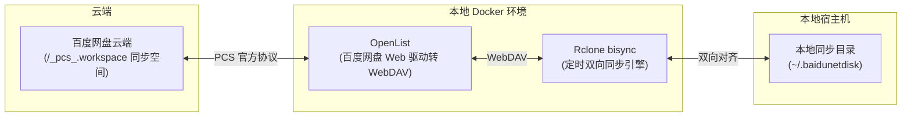

# 百度网盘 Linux 双向离线同步系统 (OpenList + Rclone)

针对百度网盘 Linux 客户端缺失“同步盘/同步空间”本地双向同步功能打造的轻量级自动化方案。

## 架构原理



- **底层定位**：百度网盘的“同步空间”在底层系统路径为 `/_pcs_.workspace`。
- **协议转换**：通过 [OpenList](https://github.com/OpenListTeam/OpenList) 网页端驱动挂载 `/_pcs_.workspace`，并对外暴露标准 WebDAV 接口。
- **离线双向同步**：通过 `rclone bisync` 定时进行本地目录与 WebDAV 之间的双向增量同步、删除同步及冲突保护。

---

## 快速开始

### 1. 前置准备
- 确保已安装并登录了百度网盘官方 Linux 客户端（本系统会自动提取已登录的凭证）。
- 确保系统已安装 Docker 与 Docker Compose。

### 2. 一键自动初始化与部署
在项目根目录下运行全自动初始化脚本：
```bash
python3 scripts/setup.py
```
> [!NOTE]
> OpenList v4.1.0+ 容器以非 root 用户 `openlist` (UID: 1001) 运行。脚本会自动初始化 `./data` 目录并赋予相应权限；如直接运行 `docker compose up`，需先执行 `chmod -R 777 ./data`。
脚本将全自动完成：
1. 从官方客户端 Cookies 中提取 `BDUSS`。
2. 生成 `.env` 配置并创建本地 `~/.baidunetdisk` 目录。
3. 启动 OpenList 容器。
4. 调用 OpenList API 自动添加 `/_pcs_.workspace` 存储（无需手动在网页界面填写）。
5. 启动 Rclone 同步容器并开启后台定时双向增量同步。

---

## 常用运维命令

### 查看同步状态与日志
```bash
docker compose logs -f rclone-sync
```

### 手动立即触发一次双向同步
```bash
./scripts/manual-sync.sh
```

### 访问 OpenList 管理界面
浏览器打开：`http://127.0.0.1:5244`
- 默认管理员账号：`admin`
- 默认管理员密码：可在 `.env` 中的 `OPENLIST_ADMIN_PASSWORD` 查看或修改。

### 停止 / 重启服务
```bash
# 停止
docker compose down

# 启动
docker compose up -d
```

---

## 核心配置说明 (`.env`)

| 环境变量 | 默认值 | 作用说明 |
| :--- | :--- | :--- |
| `LOCAL_SYNC_DIR` | `~/.baidunetdisk` | 宿主机本地需要同步的绝对路径 |
| `OPENLIST_PORT` | `5244` | OpenList 映射到主机的 Web 端口 |
| `SYNC_INTERVAL` | `300` | 自动增量双向同步的轮询间隔（秒） |
| `WEBDAV_WORKSPACE_PATH` | `workspace` | 挂载在 OpenList 内部的虚拟路径名 |
| `RESYNC_ON_START` | `false` | 若发生严重不一致时设为 `true` 强制重新对齐基准 |

---

## 目录结构

```
.
├── docker-compose.yml       # Docker 服务编排
├── .env.example             # 环境变量配置模板
├── .gitignore
├── README.md                # 使用说明
├── data/                    # OpenList 与 Rclone 本地数据（自动持久化）
└── scripts/
    ├── extract-cookie.py    # 从客户端提取 BDUSS
    ├── setup.py             # 一键安装初始化流水线
    ├── sync-daemon.sh       # Rclone 容器内守护进程
    └── manual-sync.sh       # 手动即时同步脚本
```
